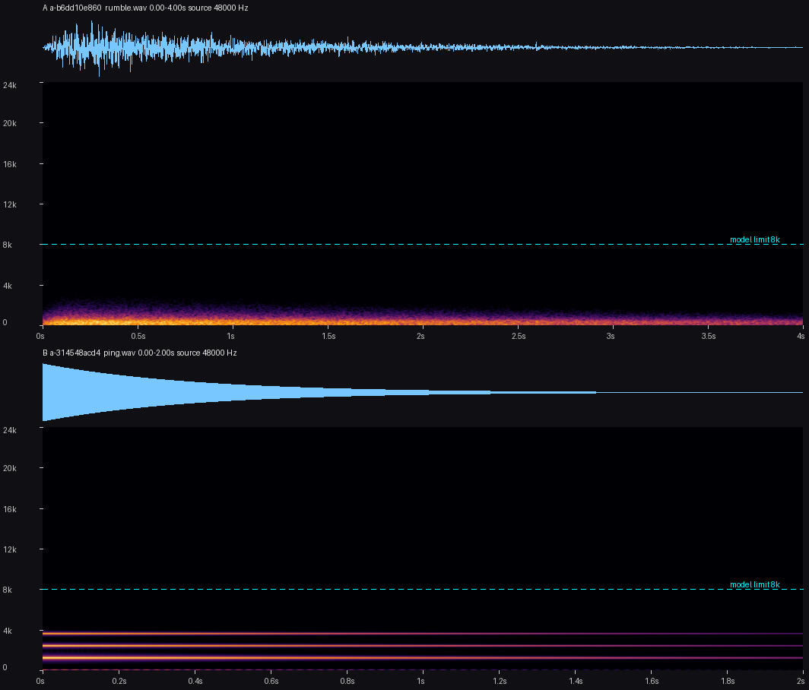
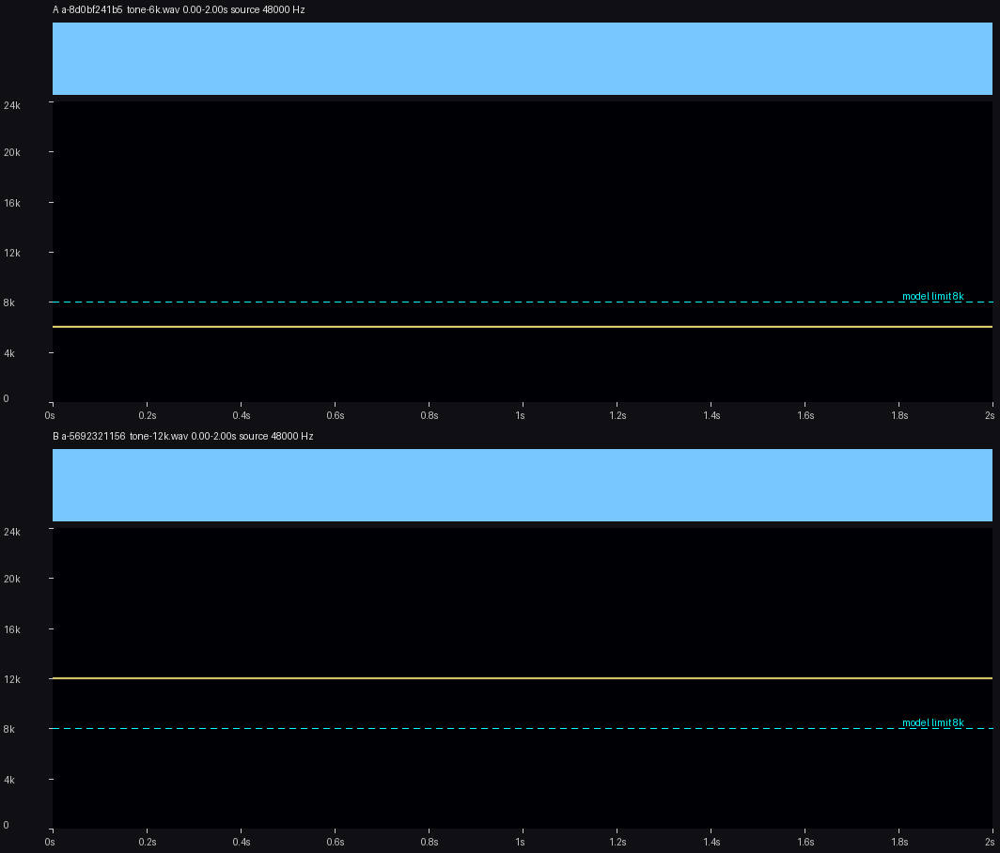

# Audio-Describe-MCP

**Let an LLM agent *see* sound.** An MCP server that turns any audio file into things a model can read: a stable **ID**, a **numeric signature**, and a **spectrogram image**. No index to build, no model to download, and nothing leaves your machine.

[한국어](README.ko.md)

LLMs cannot hear. When an agent has to tell sound effects apart ("is this the thunder I generated yesterday or the new one?", "does this whoosh have any hiss above 8 kHz?"), it has nothing to look at. This server gives it three things for any file you point it to:

| | what the agent gets | how |
|---|---|---|
| **ID** | `a-b6dd10e860`: identical copies of a file share it | SHA-1 of the file bytes |
| **Signature** | level, dominant / centroid frequency, energy per band (including above 8 kHz), attack, decay, noise-vs-tone | FFT, envelope (numpy / scipy) |
| **Picture** | a PNG: waveform on top, spectrogram below, kHz and second ticks, a dotted line at 8 kHz | Pillow; a vision-capable model opens it as an image |

Optionally, `semantic=true` also asks Google's EmbeddingGemma 2 whether two sounds are the *same kind* of sound (see [Optional: semantic comparison](#optional-semantic-comparison)). The core does not need it.

## Example

`audio_describe` on a synthetic thunder-like rumble (made by [`examples/make_examples.py`](examples/make_examples.py)):

```
a-b6dd10e860  rumble.wav  4.00 s, 48000 Hz, 1 ch
level: rms -25.6 dBFS, peak -7.8 dBFS | attack 160 ms, decay 2425 ms | flatness 0.558 (noise-like)
spectrum: dominant 35 Hz, centroid 189 Hz, 95% of the energy below 398 Hz
bands: <500 Hz 99% | 500-2k 1% | 2k-8k 0% | >8k 0%   (the optional embedding model only hears up to 8 kHz)
spectrogram: <cache>/a-b6dd10e860_0_4000.png   (open it as an image: waveform on top, 0-24 kHz below, dotted line = 8 kHz)
```

`audio_compare` on that rumble and a bell-like ping: the table says what differs, and the stacked picture shows A on top, B below, on the same frequency scale.

```
notable differences: duration 4.00 s -> 2.00 s; dominant 35 Hz -> 1195 Hz; centroid 189 Hz -> 1543 Hz; flatness 0.56 -> 0.00;
<500 Hz 99% -> 0%; 500-2k 1% -> 76%; 2k-8k 0% -> 24%; attack 160 ms -> 0 ms; decay 2425 ms -> 1385 ms
```



Tones above 8 kHz are what the signature and the picture are for (the optional embedding model cannot hear them): a 6 kHz and a 12 kHz sine give `2k-8k 100% -> 0%; >8k 0% -> 100%`, and the picture shows the second line above the dotted 8 kHz line.



## Tools

| tool | what it does |
|---|---|
| `audio_describe(path, start_s=0, end_s=None, spectrogram=True)` | ID, signature and spectrogram PNG of **any** audio file (wav mp3 flac ogg m4a opus aac wma). At most 300 s per call; use `start_s` / `end_s` for other parts. |
| `audio_compare(a, b, semantic=False, spectrogram=True)` | `b` is one file or a list of up to 20. Same-ID check (identical file), a table of what differs, and, with exactly one `b`, one PNG with both spectrograms stacked. With `semantic=true` the candidates are ranked by embedding similarity to `a`. |

Results are short on purpose, so they cost few tokens. The tools are read-only; they only write PNGs into the cache folder.

### How to read the signature

| field | meaning |
|---|---|
| `rms`, `peak` | level in dBFS |
| `attack` | time until the envelope first comes within 3 dB of its loudest 5 ms frame. A steady tone has attack 0. |
| `decay` | from that point until the envelope is 30 dB down; `ms+ (still audible at the end)` means it never got there |
| `dominant`, `centroid`, `95% rolloff` | strongest frequency, spectral centre of mass, frequency below which 95% of the energy lies |
| `flatness` | 0 = a tone, 1 = white noise, measured over the band the sound actually occupies; labelled noise-like (>= 0.2), mixed, tonal (< 0.05) |
| `bands` | share of the energy below 500 Hz, 500-2k, 2k-8k and above 8 kHz |

## Install

You need Python 3.10+ and [ffmpeg](https://ffmpeg.org/) (on `PATH`, or set `AUDIO_DESCRIBE_FFMPEG`).

```bash
pip install "git+https://github.com/ssain3d-lgtm/Audio-Describe-MCP.git"
```

Try it from the command line first:

```bash
audio-describe describe path/to/sound.wav
audio-describe compare path/to/a.wav path/to/b.wav
```

### Use it from an MCP client

The server speaks MCP over stdio. Claude Code:

```bash
claude mcp add audio-describe -- audio-describe-mcp
```

Any client that takes a JSON config (Qwen Code `settings.json`, Claude Desktop, ...); use the full path of the executable if it is installed in a virtual environment:

```json
{
  "mcpServers": {
    "audio-describe": {
      "command": "audio-describe-mcp",
      "env": { "AUDIO_DESCRIBE_FFMPEG": "/path/to/ffmpeg" }
    }
  }
}
```

Then ask: *"Describe `C:\sounds\thunder.wav`, open the spectrogram and tell me about pitch, length and whether it has anything above 8 kHz."* The model calls `audio_describe` and opens the PNG with its own image-reading tool.

Configuration is by environment variable, all optional:

| variable | default | |
|---|---|---|
| `AUDIO_DESCRIBE_FFMPEG` | `ffmpeg` on `PATH` | path to ffmpeg |
| `AUDIO_DESCRIBE_CACHE` | `%LOCALAPPDATA%\audio-describe-mcp\spectro` on Windows, `~/.cache/audio-describe-mcp/spectro` elsewhere | where the PNGs go (the oldest are deleted beyond 300 MB) |
| `AUDIO_DESCRIBE_MODEL` | `google/embeddinggemma-2` | model for the optional comparison |
| `AUDIO_DESCRIBE_IDLE_SECONDS` | `120` | the embedding model is released after this much disuse |
| `AUDIO_DESCRIBE_STDERR` | log file | `inherit` keeps the server's stderr. By default it is written to `server.log` next to the cache, because some clients (Qwen Code) never read a server's stderr pipe and a chatty server then hangs. |

## Optional: semantic comparison

```bash
pip install "audio-describe-mcp[semantic] @ git+https://github.com/ssain3d-lgtm/Audio-Describe-MCP.git"
```

`audio_compare(..., semantic=true)` embeds the first 30 s of each file with [EmbeddingGemma 2](https://huggingface.co/google/embeddinggemma-2) (text + audio towers, CPU, FP32; the first use downloads about 1.5 GB) and reports the cosine similarity. It is loaded on first use, kept while you keep asking, and released after 120 s idle. While loaded the process takes about 3 GB (PyTorch plus the model). It refuses to load with less than 3.5 GB of free RAM and still returns the signature table.

What it is good for, measured on this machine with sound-effect libraries:

- **Sound against sound works.** 30 effects of 6 kinds (explosion, click, thunder, laser, footstep, coin), nearest neighbour was the same kind 87% of the time (chance is 17%); mean cosine 0.94 within a kind, 0.88 between kinds. Small sample, ground truth taken from file names.
- **Text labels against sound do not.** Scoring "thunder", "explosion", ... against the audio picked the right label for 0 to 1 of 6 clips, so no label classifier is offered.
- **It cannot hear above 8 kHz** (the model reads 16 kHz audio). That range is what the signature and the picture cover.

## Limits

- The agent still does not *hear*. It reasons from numbers and a picture; treat its verdicts ("a dry buzz", "thunder-like") as informed guesses, and listen when it matters.
- `audio_describe` analyses at most 300 s per call (the response says when it cut a file). Files with a sample rate below 32 kHz (telephone-quality) or above 48 kHz get a one-line note about what they cannot contain.
- Needs ffmpeg for decoding. Nothing is sent over the network, except the optional model download.
- The tools read any local path the client passes. Run the server only for clients you trust with your files.
- Tested on Windows 11 with Python 3.12 and ffmpeg 8.0.1. The code does not use anything Windows-specific except an optional memory trim after unloading the embedding model, but Linux and macOS are untested.

## Measured performance

On a Ryzen 9 9950X3D (CPU only: the model is built with `device="cpu"`):

| | |
|---|---|
| `audio_describe` on a 17.8 s stereo mp3, with PNG | about 0.15 s; the whole process is about 100 MiB (base install, no PyTorch) |
| `audio_compare` signature table only | about 0.5 s |
| first `semantic=true` (imports PyTorch, loads the model, 3 files) | about 12 s; the process grows to about 2.9 GB |
| the same again, model already loaded | about 4 s |
| after the idle release (Windows) | working set back to the starting level (about 1 MiB right after the trim) |

## Verified with a real agent

A local vision-capable model (Qwen3.8-based, served by [Strata](https://github.com/Niko1221/Strata)) driven by Qwen Code was given two spectrograms with their file names hidden behind `tone_a` / `tone_b` and asked which one has energy above the dotted 8 kHz line. It opened both PNGs and answered correctly (about 12 kHz vs about 6 kHz). Other vision-capable clients should work the same way, but have not been tried.

## Development

```bash
python -m venv .venv && .venv/bin/pip install -e ".[dev]"     # Windows: .venv\Scripts\pip
pytest                                                         # tests that need torch are skipped without the extra
pip install -e ".[semantic]" && pytest                         # also runs the semantic tests (they use a stand-in model: no download)
python examples/make_examples.py                               # regenerates docs/img and prints sample output
```

The tests make their own synthetic sounds (no audio files are shipped) and include a stdio test that starts the real server and calls both tools like an MCP client does.

```
src/audio_describe_mcp/
  signature.py     ffmpeg decode, ID, window, signature, comparison table   (numpy / scipy)
  spectrogram.py   the picture, the stacked picture, the cache pruning      (Pillow)
  core.py          Describer.describe / .compare and the text a model reads
  semantic.py      optional EmbeddingGemma 2 encoder with idle release
  server.py        MCP stdio server (two tools)       cli.py   command line
```

## License

MIT, see [LICENSE](LICENSE). The optional model is Google's EmbeddingGemma 2 (tagged Apache-2.0 on Hugging Face; its model card also points to the Gemma Prohibited Use Policy); you download it yourself and its terms apply to it. ffmpeg is a separate program with its own license.
